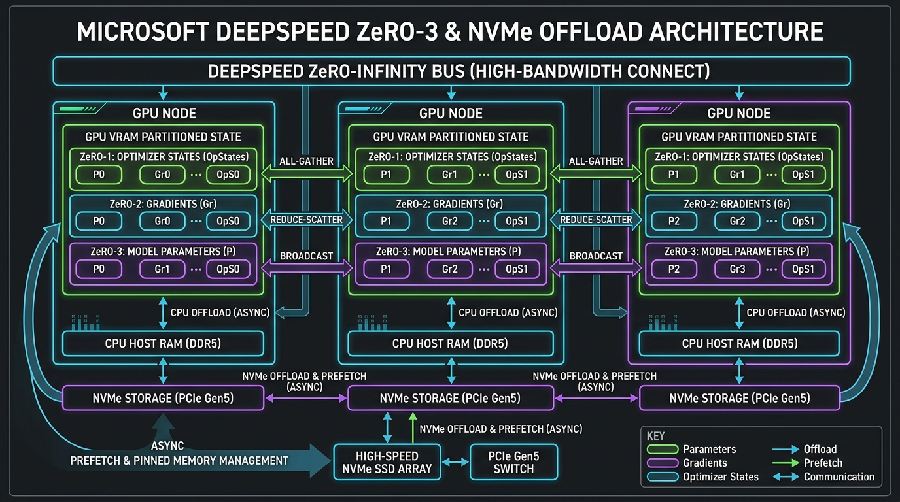

[](https://pradeeptalari.me/projects/)
[](https://pradeeptalari.me/tools/repo-learning/)

# Microsoft DeepSpeed ZeRO-3 & NVMe Offload Studio

[](https://github.com/Pradeeptalari14/tp-deepspeed-zero-offload/actions)
[](LICENSE)
[](https://talaripradeep.info)

Production-grade **DeepSpeed ZeRO-3 (Zero Redundancy Optimizer)** and **NVMe / CPU Asynchronous Offload** engine for massive distributed LLM training and fine-tuning.



## Key Technical Highlights
- **8x VRAM Footprint Reduction:** Partitions optimizer states (ZeRO-1), gradients (ZeRO-2), and model parameters (ZeRO-3) across nodes, keeping only active layer weights in GPU memory.
- **ZeRO-Infinity NVMe Offload:** Streams model parameters directly from high-speed PCIe Gen5 NVMe arrays with asynchronous prefetching.
- **70B Training on Budget GPUs:** Trains and fine-tunes 70B parameter models on small GPU footprints without out-of-memory (OOM) crashes.
- **Communication Overlapping:** Overlaps gradient reduce-scatter and parameter all-gather collectives with forward and backward computation.

## Quickstart
```bash
git clone https://github.com/Pradeeptalari14/tp-deepspeed-zero-offload.git
cd tp-deepspeed-zero-offload
bash scripts/validate.sh
```

---
*Synchronized with [Microsoft DeepSpeed ZeRO-3 & NVMe Offload Studio Studio](https://pradeeptalari.me/tools/deepspeed-zero-offload/) & [Repository Learning DAG](https://pradeeptalari.me/tools/repo-learning/) — [Talari Pradeep Portfolio](https://pradeeptalari.me)*
